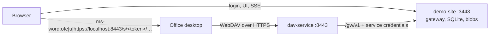

# Office over WebDAV, through a pluggable gateway (POC)

A user signs in to a demo site, clicks **Edit in Word**, and the file opens in
Office desktop on Windows. Every Ctrl+S goes through a WebDAV service, becomes a
new version, and the demo site's version list and preview update live.

The product here is **`dav-service`**. It is stateless and knows only one thing:
the Gateway API (`/gw/v1`). Authentication, authorization, storage, versions and
locks all live behind that API. In this POC the demo site implements it; in
production the real web app implements the same contract and `dav-service`
moves over unchanged.



## Contents

- [Repository layout](#repository-layout)
- [Quick start](#quick-start)
- [Windows setup](#windows-setup)
- [How it works](#how-it-works)
- [Configuration](#configuration)
- [Gateway API (/gw/v1)](#gateway-api-gwv1)
- [Tests](#tests)
- [Manual checklist](#manual-checklist)
- [Capturing Office's traffic](#capturing-offices-traffic)
- [Observed Office behaviour](#observed-office-behaviour)
- [Porting to production](#porting-to-production)
- [Decisions and deviations from the brief](#decisions-and-deviations-from-the-brief)
- [Known limitations](#known-limitations)

## Repository layout

```
packages/gateway-contract/  zod schemas + types for /gw/v1, and the dav URL helpers. Shared by both sides.
services/dav-service/       Fastify WebDAV server. The reusable product. Stateless.
apps/demo-site/             Fastify demo app: mock login, UI, SSE, and the /gw/v1 implementation.
test/                       Integration tests: start both services and replay Office's request sequence.
scripts/                    certs, preflight (.env), office-trace, make-big-xlsx.
certs/                      mkcert output (gitignored).
```

`dav-service` imports nothing from `apps/demo-site`. A test
(`services/dav-service/test/boundary.test.ts`) fails the build if any of its
source files imports anything other than its own files, Node built-ins, or the
dependencies declared in its `package.json`, of which the only workspace package
is the contract.

## Quick start

Prerequisites: Node 22.12 or newer, [mkcert](https://github.com/FiloSottile/mkcert),
and for the real thing, Windows with Office desktop (Microsoft 365 or 2016+).

```sh
npm install
npm run certs     # mkcert -install, then certs/localhost.pem + key, and certs/rootCA.pem
npm run dev       # starts demo-site (https://localhost:3443) and dav-service (https://localhost:8443)
```

Open <https://localhost:3443>, pick **Alice**, and click **Edit in Word** next to
*Project Plan.docx*.

`npm run dev` first runs `scripts/preflight.mjs`, which checks the certificates
and, on first run, writes a `.env` with fresh `GATEWAY_SECRET` and
`COOKIE_SECRET` values. Both services read that file; edit it to change any
setting from [Configuration](#configuration). `npm start` is the same without
file watching.

On first start the demo site seeds four files: a docx, an xlsx, a pptx, and
`תוכנית עבודה (טיוטה).docx` (Hebrew, with spaces and parentheses). Delete
`apps/demo-site/data/` to start over.

## Windows setup

Office only opens WebDAV URLs over HTTPS with a certificate Windows trusts.

**Running everything on Windows.** `npm run certs` runs `mkcert -install`, which
adds the mkcert root CA to the Windows certificate store. Nothing else is needed.
Install mkcert with `winget install FiloSottile.mkcert` (or Chocolatey/Scoop).

**Running the services in WSL2.** Office trusts the *Windows* store, not WSL's,
so the CA has to be installed on the Windows side too. Two ways:

1. Share one CA. Install mkcert on Windows and run `mkcert -install` there. Then in WSL:
   ```sh
   export CAROOT=/mnt/c/Users/<you>/AppData/Local/mkcert
   npm run certs
   ```
   WSL now signs `certs/localhost.pem` with the CA Windows already trusts.
2. Or import WSL's root into Windows, from PowerShell (as the current user):
   ```powershell
   certutil -user -addstore Root "\\wsl.localhost\<distro>\home\<you>\office-dav-poc\certs\rootCA.pem"
   ```
   `npm run certs` prints this command with your paths filled in.

WSL2 forwards `localhost` from Windows to services listening on `localhost` in
WSL by default. If Office cannot connect, set `HOST=0.0.0.0` in `.env`, or switch
WSL to mirrored networking.

**Protected View or read-only.** If files open in Protected View or read-only,
add the site to the Local intranet zone: *Internet Options → Security → Local
intranet → Sites → Advanced*, add `https://localhost`, and restart Office.

**Browser prompt.** The first time you click Edit, the browser asks whether to
open Word. Allow it, and optionally tick "always allow" for localhost.

## How it works

1. The user signs in on the demo site (mock login; see `apps/demo-site/src/auth/`).
2. **Edit in Word** calls `POST /api/files/:id/edit-session`. The demo site checks
   write permission, creates a DAV session with a random token, and returns
   `ms-word:ofe|u|https://localhost:8443/s/<token>/<fileId>/<url-encoded name>`
   (`ms-excel:` and `ms-powerpoint:` for xlsx and pptx).
3. The browser navigates to that URI and Office opens the file from `dav-service`.
4. On every request `dav-service` resolves the token through the gateway (cached
   for `RESOLVE_CACHE_MS`), then serves the method by calling the gateway.
5. On each PUT the gateway stores an immutable blob, records a version, and
   pushes an SSE event. The demo site's page refreshes its version list and
   preview without a reload.

### URL space

| Path | Meaning |
| --- | --- |
| `/s/:token/:fileId/:fileName` | The file. |
| `/s/:token/:fileId/` | A collection containing only that file. |
| `/`, `/s/`, `/s/:token/` | Minimal collections for Office's parent-path probes (OPTIONS, PROPFIND Depth 0). |
| `…/_vti_bin/…`, `…/_vti_inf.html` | Fast 404 without calling the gateway (SharePoint/FrontPage probes). |

A `:fileId` other than the session's file is a 404. Any other name in the file's
collection (for example `~$Plan.docx`) is also a 404, or a 403 for PUT and LOCK,
because creating files is out of scope. Names are compared after Unicode NFC
normalisation and case folding. `href`s percent-encode UTF-8, with only RFC 3986
unreserved characters left literal.

### Methods

| Method | Behaviour |
| --- | --- |
| OPTIONS | `200`, `DAV: 1,2`, `MS-Author-Via: DAV`, `Allow: OPTIONS, GET, HEAD, PUT, PROPFIND, PROPPATCH, LOCK, UNLOCK`. |
| PROPFIND | `207`. Depth 0 on the file, Depth 1 on its collection. `allprop`, `propname`, `prop`, or an empty body. Unknown properties come back in a `404` propstat. |
| PROPPATCH | `207` with success for every property; nothing is stored. |
| GET / HEAD | Streams from the gateway. `ETag: "<versionId>"`, `Last-Modified`, exact `Content-Type`, `Content-Length`. Honours `If-None-Match` and `If-Modified-Since`. |
| LOCK | New exclusive write lock: `200`, `lockdiscovery` body, `Lock-Token` header, `owner` echoed. Refresh: `If` header and no body. `Timeout: Second-N` capped at `LOCK_MAX_TIMEOUT_S`. Shared locks: `412`. |
| UNLOCK | Requires `Lock-Token`. `204`. |
| PUT | Requires a lock token from `If`, in either `(<token>)` or `<url> (<token>)` form. The body streams to the gateway without buffering. `204` with the new `ETag`. |
| MOVE, COPY, DELETE, MKCOL | `403`. |

### Session and lock policy (gateway side)

Implemented in `apps/demo-site/src/domain/dav-policy.ts`, with every
check-then-write inside one transaction:

- Tokens are 32 random bytes, base64url. Only `sha256(token)` is stored.
- There is no idle timeout. `max_expires_at` (creation + `TOKEN_MAX_AGE_S`, default
  7 days) is a backstop. Beyond it: `401 beyond_cap`.
- Revoked (logout, admin revoke, permission removed) is always `401 revoked` and
  can never be revived. Revoking a session also releases its lock.
- Every successful LOCK or PUT refreshes the session's `last_seen_at` and the
  lock's `expires_at`.
- **Acquire** succeeds if there is no lock row or the row has expired; otherwise
  `423` with `heldBy`. It records `base_version_id` = the current version.
- **Revival**: a LOCK refresh or PUT under an expired lock succeeds, with
  `revived: true`, when (1) the session is live, (2) the token matches the row,
  (3) no other session holds an active lock (else `423`), and (4)
  `current_version_id == base_version_id` (else `412`).
- **PUT** needs the caller's lock to be active or revivable. The gateway checks
  this before reading the body, writes the blob, then in one transaction re-checks
  the lock, inserts the version, moves `current_version_id`, and sets the lock's
  `base_version_id` to the new version.
- **Web upload while locked**: `409`.

## Configuration

Every setting is an environment variable. `npm run dev` loads the repo-root
`.env` into both services. Relative paths are resolved from each service's
directory.

### dav-service

| Var | Purpose | Default |
| --- | --- | --- |
| `PORT` | HTTPS port | `8443` |
| `HOST` | Listen address | `localhost` |
| `TLS_CERT`, `TLS_KEY` | Certificate and key | `../../certs/localhost.pem`, `../../certs/localhost-key.pem` |
| `TLS_DISABLED` | Serve plain HTTP, only behind a TLS-terminating proxy | `false` |
| `PUBLIC_BASE_URL` | Base of PROPFIND `href`s | `https://localhost:8443` |
| `GATEWAY_URL` | Gateway base URL | `https://localhost:3443/gw/v1` |
| `GATEWAY_SECRET` | Service-to-service secret | required |
| `GATEWAY_CA_FILE` | Extra CA to trust for the gateway's certificate (the mkcert root in dev) | none |
| `MAX_UPLOAD_MB` | PUT body limit | `512` |
| `LOCK_MAX_TIMEOUT_S` | Cap for the granted lock timeout | `3600` |
| `RESOLVE_CACHE_MS` | Cache of `resolve` results per token (`0` disables) | `5000` |
| `DAV_LOG_HEADERS` | Log full request and response headers, token redacted | `false` |
| `LOG_LEVEL` | pino level | `info` |

### demo-site

| Var | Purpose | Default |
| --- | --- | --- |
| `PORT`, `HOST` | Listen address | `3443`, `localhost` |
| `TLS_CERT`, `TLS_KEY`, `TLS_DISABLED` | As above | as above |
| `DATA_DIR` | SQLite database and blobs | `data` (i.e. `apps/demo-site/data`) |
| `GATEWAY_SECRET` | Must match dav-service | required |
| `COOKIE_SECRET` | Signs the login cookie (32+ chars) | required |
| `DAV_PUBLIC_URL` | dav-service base URL used in Office URIs | `https://localhost:8443` |
| `TOKEN_MAX_AGE_S` | Session backstop | `604800` (7 days) |
| `LOCK_MAX_TIMEOUT_S` | Cap for the granted lock timeout | `3600` |
| `MAX_UPLOAD_MB` | Upload limit (web and DAV) | `512` |
| `SEED` | Seed the sample files when the database is empty | `true` |
| `LOG_LEVEL` | pino level | `info` |

### Logging

Both services log JSON with pino. `dav-service` never logs the session token:
URLs and header values pass through `redactUrl` (`/s/[token]/…`), and each line
carries the `sessionId` once the token resolves. `dav-service` reuses its request
id as `X-Request-Id` on every gateway call, so both services' log lines for one
Office request share a `reqId`.

## Gateway API (/gw/v1)

Schemas live in `packages/gateway-contract/src/schemas.ts`. Every call carries
service credentials (`Authorization: Bearer <GATEWAY_SECRET>` in the POC) and
`X-Request-Id`, plus `X-Dav-Session` once the session is known.

| Endpoint | Request | Response |
| --- | --- | --- |
| `POST /sessions/resolve` | `{ token, intent: "read" \| "write" \| "lock" }` | `200 { sessionId, userId, displayName, fileId, canWrite, state: "active" \| "expired" }`, or `401 { reason: "unknown" \| "revoked" \| "beyond_cap" }` |
| `GET /files/:fileId` | | `200 { fileId, name, mime, size, versionId, updatedAt, createdAt, lock: null \| { lockToken, ownerXml, expiresAt, timeoutS, sessionId } }` |
| `GET /files/:fileId/content` | | `200` stream with `ETag`, `Content-Type`, `Content-Length`, `Last-Modified`, `X-Version-Id` |
| `PUT /files/:fileId/content` | stream; `X-Dav-Session`, `X-Lock-Token`, `Content-Length` | `201 { versionId, size, updatedAt, revived }`, or `412`, `423` |
| `POST /locks` | `{ fileId, sessionId, timeoutS, ownerXml?, lockToken? }` | `200 { lockToken, expiresAt, timeoutS, revived }`, or `412`, `423 { heldBy: { userId, displayName, since } }` |
| `DELETE /locks/:lockToken` | `X-Dav-Session` | `204` |

Notes:

- Every error body is `{ error, message?, reason?, heldBy? }`, where `error` is a
  code (`session_invalid`, `locked`, `precondition_failed`, and so on). A `401`
  whose `error` is `gateway_auth` means the *service* credentials were rejected.
- `resolve` is read-only and idempotent. `state: "expired"` means the session is
  valid but its lock has lapsed and may be revived; dav-service treats it like
  `active`.
- When `X-Dav-Session` is present, the gateway re-checks the session on every
  call, so revocation takes effect immediately even while dav-service holds a
  cached `resolve`.
- `lock` in `GET /files/:fileId` is the active lock only; an expired lock is `null`.
- dav-service maps gateway outcomes to WebDAV statuses in one place
  (`services/dav-service/src/gateway/errors.ts`): `401→401`, `403→403`,
  `404→404`, `409→409`, `412→412`, `413→413`, `423→423`, `400→400`, and
  network errors, unparseable responses or `5xx` → `503`.

## Tests

```sh
npm test                  # everything
npm run test:unit         # contract, dav-service, demo-site
npm run test:integration  # both services as real processes over HTTPS
npm run typecheck
```

- **Unit, demo-site** (`apps/demo-site/test/policy.test.ts`, `gateway.test.ts`):
  the whole of the policy with a fake clock: acquire, conflict, refresh, each
  revival condition, revoked, beyond the cap, PUT rules (including a lock removed
  mid-upload and the orphaned blob being deleted), and the `/gw/v1` routes through
  `inject`.
- **Unit, dav-service** (`services/dav-service/test/`): `If`/`Timeout`/`Depth`
  parsing, URL space, XML parsing and rendering, the error mapping, log
  redaction, every method against an in-memory fake gateway, and the import
  boundary.
- **Integration** (`test/src/office-sequence.test.ts`): generates a certificate,
  starts both services from their real entry points with
  `LOCK_MAX_TIMEOUT_S=3`, and replays Office's sequence with undici: `OPTIONS /`
  and the file; PROPFIND Depth 0 and Depth 1; LOCK and GET; PUT with
  `If: (<token>)` and check the ETag and the new version (also over SSE); LOCK
  refresh, a second PUT with a tagged `If`, and UNLOCK. Failure paths: a second
  session's LOCK (`423`), PUT without a lock (`423`), a revoked session (`401`,
  despite a warm resolve cache), logout, an expired lock revived by PUT
  (`lock.revived` over SSE), an expired lock overtaken by another session's save
  (`412`), force unlock (`412`), web upload while locked (`409`), a wrong
  `fileId` (`404`), the Hebrew file name round-tripping through PROPFIND
  `href`s, a 20 MB streamed PUT, and a check that no token reaches either
  service's logs.

## Manual checklist

Run on Windows with `npm run dev`. Keep the file page open in the browser to
watch the live updates.

- [ ] **Word, Excel, PowerPoint**: open each seeded file with Edit, change it,
      Ctrl+S, close. Each save adds a `dav` version and refreshes the preview
      (docx and xlsx) without a reload; closing clears the lock badge.
- [ ] **Two quick saves in a row**: two versions, no error in Office.
- [ ] **Sleep longer than `LOCK_MAX_TIMEOUT_S`**, then save. It must succeed by
      revival (activity shows "expired lock revived"). To avoid waiting an hour,
      set `LOCK_MAX_TIMEOUT_S=120` in `.env` and restart.
- [ ] **Bob opens a file Alice has locked** (second browser profile, sign in as
      Bob; the Edit button warns first). Expect Office to report the file as
      locked and offer read-only; dav-service answers Bob's LOCK with `423`.
- [ ] **Revoke the session mid-edit** (Admin → Revoke session), then save.
      Expect Office to report that the upload failed, without a password
      prompt; no version is created.
- [ ] **Force unlock while Office is open**, then save. Expect the save to fail
      (`412`); no version is created.
- [ ] **A 100 MB xlsx**: `npm run make-big-xlsx` writes `big-100mb.xlsx`. Upload
      it, open it in Excel, edit a cell, save. (The preview is skipped above
      20 MB.)
- [ ] **A Hebrew file name**: open `תוכנית עבודה (טיוטה).docx`, save, and check
      that Office's title bar shows the name correctly.

## Capturing Office's traffic

Set `DAV_LOG_HEADERS=true` in `.env`, then:

```sh
npm run dev 2>&1 | tee office.log        # use Office, then stop
npm run office-trace -- office.log       # one line per request, with the headers that matter
```

## Observed Office behaviour

**Not captured yet.** This POC was built and tested on Linux without Office. The
integration tests replay the sequence the brief describes, not a recording. After
the first run on Windows, record here every place where Office's real traffic
(from `npm run office-trace`) differs from this document, for example:

- the first requests Office sends, and on which paths (root, `/s/`, `/s/<token>/`, the collection);
- which properties its PROPFIND asks for, and whether it sends PROPPATCH;
- the `Timeout` it requests and how often it refreshes the lock;
- whether PUT uses the tagged or untagged `If` form, and whether it sends `If-Match`;
- how it reacts to `401` (our `WWW-Authenticate: Bearer`), `412` and `423`;
- how it encodes the Hebrew file name.

The implementation already allows for behaviour that public documentation
describes but that has not been verified here: SharePoint/FrontPage probes
(`_vti_bin`, `_vti_inf.html`), PROPFIND on parent collections, PROPFIND for
Microsoft-namespace properties (answered with a `404` propstat), PROPPATCH of
Windows timestamps, and both forms of the `If` header.

## Porting to production

`dav-service` needs no code changes; only its configuration changes. The
replacement work is all on the web-app side.

**Implement `/gw/v1` in the real app.** Port `apps/demo-site/src/gateway/`
(routes and service auth) together with `domain/dav-policy.ts` and
`domain/files.ts`. They depend only on a repository, a blob store, an event bus
and a permissions check. Validate requests and responses with
`@office-dav/gateway-contract`. Keep the contract tests
(`apps/demo-site/test/gateway.test.ts`) running against the real implementation.

**MockOidcAuth → OIDC.** `apps/demo-site/src/auth/auth.ts` is the seam:
`getCurrentUser(req)`, `login(reply, userId)` (called from the OIDC callback once
the ID token is verified), and `logout`. Keep the two hooks: `onLogin` upserts the
user (JIT provisioning), and `onLogout` revokes the user's DAV sessions. When a
permission is removed, call `revokeSession` for that user's sessions on the file.

**SQLite → PostgreSQL.** Table and column names already match. Use
`timestamptz` for the epoch-millisecond columns. Run each policy method in a
transaction and take the lock row with `SELECT … FOR UPDATE`, or make acquire a
single `INSERT … ON CONFLICT (file_id) DO UPDATE … WHERE file_locks.expires_at <= now()`
so that two acquirers cannot both win. Keep `UNIQUE (file_id, version_no)` as a
backstop for concurrent saves.

**BlobStore → S3.** Implement `BlobStore` (`put` streaming with a size cap, `get`,
`delete`) on S3 multipart upload. Keep keys immutable (`<fileId>/<versionId>`),
compute sha256 while streaming (or use S3's checksum), and delete the object when
the version transaction fails, as `FileService.saveFromDav` does today.

**Gateway secret → signed JWT or mTLS.** On the dav-service side, swap
`bearerAuth(secret)` for an `authProvider` that returns
`{ authorization: 'Bearer <short-lived JWT signed with dav-service's private key>' }`;
it is called per request, so it can cache and rotate tokens. On the gateway
side, replace `sharedSecretAuth` with JWT verification against dav-service's
public key (check `iss`, `aud`, `exp`). For mTLS, give dav-service's undici
`Agent` a client certificate (`connect: { cert, key }`) and verify it at the
gateway's TLS terminator.

**Deploying dav-service.** `npm run build` writes a single bundled
`services/dav-service/dist/main.js` that runs with `node` and no `node_modules`.
Instances are stateless and can scale horizontally: locks live in the gateway,
and the resolve cache is per instance and short. Behind a TLS-terminating load
balancer, set `TLS_DISABLED=true` and `PUBLIC_BASE_URL` to the public origin.
Allow request bodies up to `MAX_UPLOAD_MB` and do not buffer them at the proxy.

**SSE across instances.** `EventBus` is in-process. With several web-app
instances, publish through Redis or Postgres `LISTEN/NOTIFY`.

## Decisions and deviations from the brief

- **`revived` in the PUT response.** `PUT /files/:fileId/content` returns
  `{ versionId, size, updatedAt, revived }`, so callers can see a revival, as
  `POST /locks` already shows.
- **Service-auth failures.** A gateway `401` maps to WebDAV `401` per the table,
  but when its `error` is `gateway_auth` dav-service also logs an error, because
  the cause is its own credentials, not the user's session.
- **Extra statuses.** Gateway `400`, `404` and `409` pass through; any other
  unexpected `4xx` becomes `500` (a contract mismatch).
- **PUT with the wrong token while the file is locked** returns `423` (the
  caller does not hold the active lock). The same request when no active lock
  exists returns `412` (condition 2).
- **UNLOCK of an unknown token** is `204`: the lock is already gone (it expired
  and was replaced, or was force-unlocked). UNLOCK of another session's lock is `403`.
- **Revocation releases the lock**, so other users are not blocked by a dead session.
- **The resolve cache** saves a round trip per request. Every call that touches
  the file goes back to the gateway with `X-Dav-Session` and is re-checked there,
  so within `RESOLVE_CACHE_MS` of a revocation only the synthetic parent
  collections can still answer.
- **`/s/`** is answered like `/` and `/s/:token/`, in case Office probes it.
- **401 responses** carry `WWW-Authenticate: Bearer realm="office-dav"`. Office
  cannot answer a Bearer challenge, so it should fail the request rather than
  prompt for a password. This is unverified; see
  [Observed Office behaviour](#observed-office-behaviour).
- **Extra SSE events**: `lock.refreshed`, `file.created` and `session.revoked`,
  besides the four required ones.
- **Lock tokens are bound to their session**, so another session cannot present
  them, even for the same user.

## Known limitations

- Reopening a file in a new session after Office crashed without UNLOCK gets
  `423` until the old lock expires (or an admin force-unlocks it), as the acquire
  rule requires.
- The demo site's preview uses SheetJS `xlsx@0.18.5`, the last version on npm.
  It has published advisories for crafted files. SheetJS distributes fixed
  versions from its own CDN
  (`npm i https://cdn.sheetjs.com/xlsx-0.20.3/xlsx-0.20.3.tgz`), which this
  build environment could not reach. `npm audit` also reports advisories in
  transitive dependencies of `mammoth`, `exceljs` and `pptxgenjs`. All of them
  are in the demo site's preview and seed code; `dav-service`'s dependency tree
  is clean.
- The session token is part of the URL Office opens, so it can appear in
  Office's recent-files list. It is useless after revocation or logout, and
  `TOKEN_MAX_AGE_S` bounds its life.
- Out of scope, as briefed: Mac, mobile, Office for the web, co-authoring,
  AutoSave, Save As or creating files from Office, MS-OFBA, real OIDC, PostgreSQL
  and S3.
